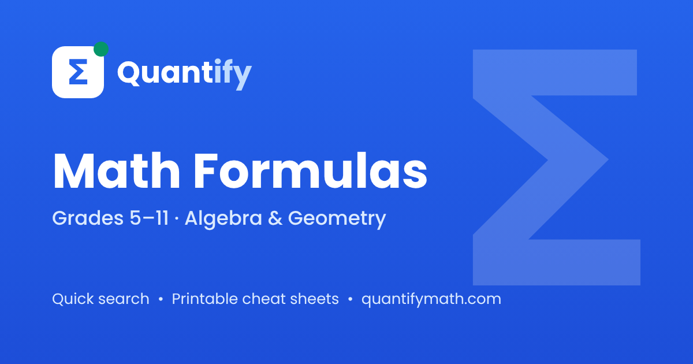

# Quantify

**A handy math formula reference for grades 5–11** — algebra, geometry, trigonometry, derivatives and integrals.

🌐 **Live site: [quantifymath.com](https://quantifymath.com)**

Available in three languages: [English](https://quantifymath.com/) · [Українська](https://quantifymath.com/uk/) · [Русский](https://quantifymath.com/ru/)



## Features

- **267 formulas** grouped into 17 topics, each topic on its own page
- **Fast search** by formula name
- **Built-in calculators** for many formulas, with diagrams and notation for each variable
- **Printable cheat sheet** — pick a grade or subject, then print or save as PDF
- **Favourites** saved in your browser
- **Works on phones** — responsive layout, no horizontal scrolling
- **No tracking cookies, no sign-in**, free to use

## Topics

Short multiplication formulas · Equations and parabolas · Triangles · Areas · Perimeters · Trapezoid · Circle · Sequences · Combinatorics and probability · Powers, roots and logarithms · Trigonometry · Table of trigonometric values · Derivatives and integrals · Antiderivatives · Vectors · Box and prism · Solid geometry

## How it is built

The site is fully static: plain HTML, CSS and a little JavaScript, hosted on [Cloudflare Pages](https://pages.cloudflare.com/). Formulas are pre-rendered with [KaTeX](https://katex.org/) at build time, so pages load fast and work without JavaScript.

Every topic has a separate URL in each language (`/`, `/uk/`, `/ru/`), with `hreflang` links, a `sitemap.xml` and a `404.html` page.

## Run locally

The pages use root-relative links, so open them through a local server rather than by double-clicking `index.html`:

```bash
python -m http.server 8000
```

Then open <http://localhost:8000>.

## Contributing

Found a mistake in a formula or a translation? Please [open an issue](../../issues) with the page address and what should be changed. Suggestions for new formulas are welcome too.

## License

[MIT](LICENSE)

---

**Українською:** Quantify — зручний довідник формул з математики для 5–11 класів. Пошук, калькулятори, шпаргалка для друку, три мови. Сайт: <https://quantifymath.com/uk/>

**По-русски:** Quantify — удобный справочник формул по математике для 5–11 классов. Поиск, калькуляторы, шпаргалка для печати, три языка. Сайт: <https://quantifymath.com/ru/>
